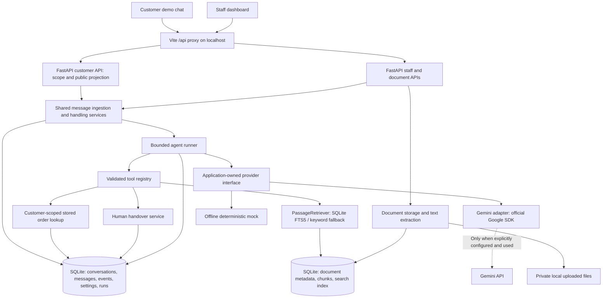

# Architecture

[Portfolio overview](../../README.md) | [Case study](case-study.md)

Two React views share the local FastAPI application: customer chat at
`/demo/customer` and the staff dashboard at `/`. Vite proxies `/api` to FastAPI.
Customer endpoints serialize only public messages and minimal scoped state;
staff endpoints supply notes, settings, citations, and run diagnostics. Both UIs
use bounded polling that pauses on hidden tabs. Demo identity selection is not
authentication, and the local staff API is intentionally unauthenticated.

## Persistence and evidence

SQLAlchemy models store customers, orders, conversations, messages, events,
settings, documents/passages, runs/tool results, and retry records. Alembic applies
explicit migrations. Startup does not seed or migrate. Upload files live outside
public frontend directories; SHA-256 detects duplicates. Text extraction runs in
a bounded subprocess and retains PDF pages or Markdown headings for citations.

Search currently uses **SQLite FTS5, not embeddings**. If FTS5 is unavailable,
parameterized keyword matching supplies a fallback. Queries are tokenized as
input, not accepted as unrestricted FTS/SQL expressions. `PassageRetriever` is the
service interface used by both document search and the agent's search tool.

The three tools are `search_knowledge_base`, `get_order_details`, and
`request_human_handover`. Order lookup enforces customer ownership and returns
fictional stored shipping information, not carrier data. Agent Activity shows
persisted tool arguments/results and saved citations separately from seeded
historical examples. Policy citation IDs and quotes must match evidence retrieved
in that run. This is provenance checking, not a general correctness guarantee.

## Provider boundary and execution

`backend/agent/types.py` defines application-owned requests, results, tool calls,
and provider/session contracts. `runner.py` controls the loop, context, bounds,
explicit retries, and publication. `gemini.py` adapts the official SDK;
`fake.py` supplies deterministic offline behavior and scripted test responses.
Neither the frontend nor the tool registry needs Google SDK types. Gemini can
send public context and retrieved excerpts to Google when explicitly enabled;
keep recordings fictional. Internal notes are excluded from model context.

Incoming messages persist before generation. Writes and idempotency responses
commit atomically, with no write transaction spanning provider I/O. Successful
tool results are cached within a run. Only one agent turn may be active per
conversation. Startup marks interrupted turns for review instead of silently
repeating provider calls. This is a single-backend-process design, not a worker fleet.

## How takeover prevents a stale AI reply

A run captures the conversation's `handling_revision`. Human takeover switches
handling to `human` and increments that revision. The runner checks revision,
status, and handling before tool execution and before saving a public answer.
An in-flight answer from the earlier revision cannot be published, even if staff
subsequently resume AI. Takeover does not guarantee cancellation of a provider
request already sent over the network.

Resume preserves messages, notes, and recorded actions, changes handling back to
`ai`, and waits for the next customer message. Status remains separate:
`open / in_progress / resolved` versus `ai / human / awaiting_human`. Resolved
tickets require explicit reopening. A successful agent handover commits its
state change and public acknowledgement together, then ends the turn.

See the [development reference](../development.md#agent-behavior-limits-and-extension-points)
for execution limits and API details. This explanation is based on inspected
code; no live Gemini verification was performed for the portfolio task.
